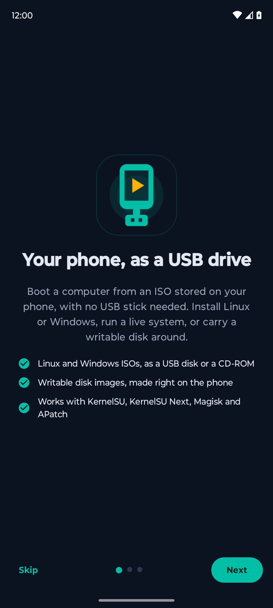
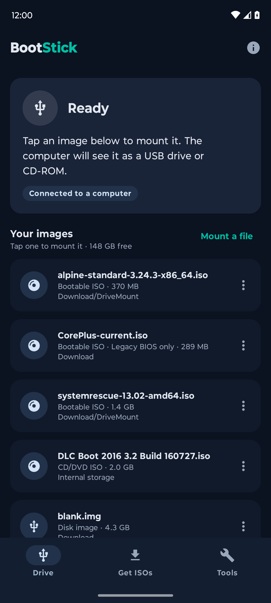
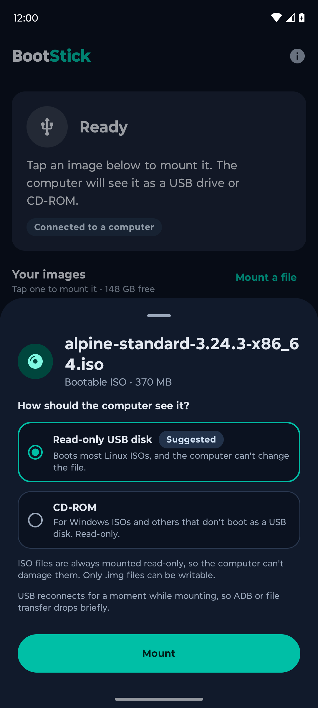
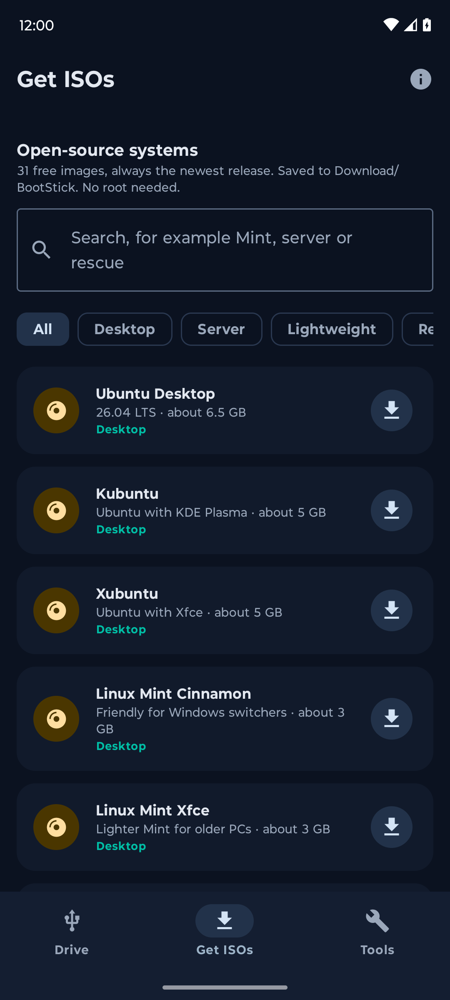

# BootStick: turn your Android phone into a bootable USB drive

[](https://github.com/muhammadaasim/bootstick/releases/latest)
[](https://github.com/muhammadaasim/bootstick/releases)
[](https://github.com/muhammadaasim/bootstick/actions/workflows/ci.yml)
[](LICENSE)


**Boot any PC from an ISO file on your phone. No USB stick, no flashing, no Rufus.**

BootStick is a free, open-source Android app that makes your rooted phone show up on a computer as a USB drive or a CD-ROM. The "drive" is an `.iso` or `.img` file stored on your phone. Plug the phone in, pick it in the boot menu, and install Linux, run a Windows installer, start a rescue system, or carry a writable disk around in your pocket.

It's an improved, open-source **DriveDroid alternative** that works with **KernelSU, KernelSU Next, Magisk and APatch**, and it works on phones where DriveDroid mounts the image but the PC sees nothing.

<p align="center">
  
  
  
  
</p>

<p align="center">
  <a href="https://github.com/muhammadaasim/bootstick/releases/latest"><b>Download the APK</b></a> ·
  <a href="#boot-a-pc-from-your-phone-in-five-steps">Quick start</a> ·
  <a href="#will-it-work-on-my-phone">Will it work on my phone?</a> ·
  <a href="#faq">FAQ</a>
</p>

> ⭐ **If BootStick is useful to you, please [star this repo](https://github.com/muhammadaasim/bootstick)!** It's free, it takes one click, and it's how other people with the same problem find it.

## Why I built this

I wanted to boot a PC from an ISO on my Motorola ThinkPhone, the way DriveDroid promises. DriveDroid said the image was mounted, but the computer saw nothing. After digging into the phone's USB setup, I found out why (it's [explained below](#why-drivedroid-fails-on-some-phones)) and wrote a script that sets up the USB drive directly. That script grew into BootStick.

So it's built for exactly the phones where the older tools give up, and everything I learned about the USB side is written down here and in the code.

## Download

**[Get the latest BootStick APK](https://github.com/muhammadaasim/bootstick/releases/latest)** (`BootStick-vX.Y.apk`).

- One APK works on every phone. There's no separate build for different processors.
- Every release comes with a `.sha256` file. To check your download: `sha256sum -c BootStick-vX.Y.apk.sha256`
- Releases are built and signed by [GitHub Actions](.github/workflows/release.yml) from the code in this repo, so what you install is what you see here.

App page: <https://aasim.site/apps/bootstick>

## Boot a PC from your phone in five steps

1. **Install BootStick and open it.** A short introduction explains how it works and checks whether root works on your phone.
2. **Give it root.**
   - **KernelSU, KernelSU Next or APatch:** there's no pop-up. BootStick shows a button that opens your root manager: find BootStick under *Superuser*, switch it on, and come back. It notices by itself.
   - **Magisk:** just allow the prompt the first time.
3. **Get an ISO.** Download one in the **Get ISOs** tab (31 Linux distributions and tools, always the newest version), or use one you already have. BootStick finds every image on your phone.
4. **Tap the image and tap Mount.** BootStick picks the right mode for you: *read-only USB disk* for most Linux ISOs, *CD-ROM* for Windows ISOs.
5. **Plug the phone into the PC and open its boot menu** (usually F12, F11, F8 or Esc while it starts; the app's boot guide lists the key for each brand). Pick the drive called `BootStik` followed by the image name.

When you're done, tap **Eject** in the app or in the notification.

## What BootStick can do

The app has three tabs: **Drive** (what's mounted, and your images), **Get ISOs** (downloads), and **Tools** (check an image, make a blank one, the boot guide and diagnostics).

### Use your phone as a USB drive (needs root)

- **Three ways to show an image, with the right one suggested:**
  - **Read-only USB disk** for hybrid ISOs, which is most Linux ISOs. They boot, and the file stays untouched.
  - **CD-ROM** for plain ISO 9660 images such as Windows installers, which only boot from a CD drive.
  - **Writable USB disk** for `.img` files: blank images, save disks, scratch drives. ISOs are never mounted writable, so a computer offering to "format" the drive can't destroy them.
- **Several drives at once.** Mount an ISO, then add a save disk next to it (handy for Tiny Core). Each one shows up as its own drive and can be removed on its own.
- **Finds your images.** It scans internal storage and SD cards for `.iso`, `.img`, `.bin`, `.raw`, `.ima`, `.dsk` and `.vhd` files, including packed ones. Phone firmware files like `boot.img` start hidden. **Mount a file** picks anything else.
- **Manages them.** Check, unpack, rename or delete any image from its menu.
- **Your image's name in the boot menu**, for example `BootStik CorePlus-current`, both in BIOS boot menus and in macOS Disk Utility.
- **Stays mounted:**
  - a notification shows what's mounted, with an Eject button;
  - switching the USB mode (say, to File transfer) keeps the drive attached;
  - eject it on your Mac, plug into a PC, and the image goes back in by itself;
  - optionally, mount it again after the phone restarts.
- **Quick Settings tile and launcher shortcuts** to mount the last image or eject without opening the app. The tile asks you to unlock first, so nobody can mount your images from the lock screen.
- **ADB keeps working** while an image is mounted.
- **Remembers** the mode you last used for each image.

### Everything else (no root needed)

- **Download Linux ISOs, always the newest release.** 31 free, open-source systems, grouped and searchable:
  - **Desktop:** Ubuntu, Kubuntu, Xubuntu, Linux Mint Cinnamon and Xfce, Fedora Workstation, Debian Live, openSUSE Tumbleweed, EndeavourOS, Pop!_OS, Manjaro KDE, NixOS
  - **Server:** Ubuntu Server, Debian net install, Rocky Linux, AlmaLinux, Proxmox VE
  - **Lightweight:** Arch Linux, Alpine, Tiny Core, netboot.xyz
  - **Rescue and tools:** SystemRescue, GParted Live, Clonezilla, Rescuezilla, Memtest86+, ShredOS
  - **Security and privacy:** Kali, Parrot Security, Tails
  - **BSD:** FreeBSD

  You can also paste any `https://` link, or share one to BootStick from your browser.
- **Downloads that don't waste your time:**
  - up to 4 parallel connections per file;
  - pause and resume any time, even after closing the app or restarting the phone;
  - dropped connections are retried, and **Retry** picks up where it stopped;
  - space is reserved up front, so a full phone fails at the start, not at 90%;
  - a half-finished file is kept as `.part`, so it never shows up as mountable;
  - **verified automatically:** when a download finishes, BootStick finds the checksum the project publishes (`SHA256SUMS`, `CHECKSUM`, `x.iso.sha256` and so on) and compares it. 25 of the 31 catalog entries publish one;
  - **unpacked automatically** when an image ships as `.img.xz`, `.iso.gz` or `.iso.zip`;
  - Wi-Fi only, if you like, and optionally saved to the SD card.
- **Check an image:** find out what a file really is (bootable hybrid ISO, CD/DVD ISO, disk image, blank, packed, or something else like phone firmware), which mode to mount it in, and whether its MD5, SHA-1, SHA-256 or SHA-512 matches the one you paste.
- **Make blank disk images** of any size, optionally **formatted as FAT32** on the phone, so Windows, macOS and Linux can use them straight away.
- **Open with BootStick** from any file manager for `.iso` and `.img` files.
- **Boot guide:** the boot menu key for common PC brands, and what to try when a computer won't boot.

The app is in English, Arabic, French, Italian, Brazilian Portuguese, Turkish, Hindi, Urdu and Sindhi. On Android 13 and newer you can choose its language separately from the phone's.

## Will it work on my phone?

The brand matters less than three things: **Android 8 or newer, root, and a kernel with USB mass storage.** That covers most phones from 2018 onward, from Motorola, Samsung, Xiaomi, OnePlus and others.

**To use your phone as a USB drive you need:**

- **Android 8 or newer** with a configfs USB gadget (nearly every phone since 2018). Older phones with the legacy `android_usb` gadget work too, one image at a time.
- **Root** from KernelSU, KernelSU Next, Magisk or APatch.
- **USB mass storage in the kernel** (`CONFIG_USB_CONFIGFS_MASS_STORAGE`). Most vendor kernels have it; if yours doesn't, BootStick tells you.
- **A USB cable that carries data.** A charge-only cable charges the phone, but the computer never sees a drive.
- **A computer that can boot from USB:** almost any PC, and Intel Macs.

**Downloads, image checks and blank images** work on any phone with Android 8 or newer, rooted or not.

You don't have to guess: the About screen (the ⓘ button) checks the first three on your phone.

| Phone | Android | Root | Result |
|---|---|---|---|
| Motorola ThinkPhone 2023 (`bronco`), GKI 5.10 | 14 | KernelSU Next | ✅ Works (tested with a Windows PC and a Mac) |

**Tried it on another phone?** Open **Tools → Diagnostics → Share** and [send the report](https://github.com/muhammadaasim/bootstick/issues/new/choose), working or not, and I'll add it to this table.

## FAQ

### Can I boot a PC from my Android phone?

Yes, if your phone is rooted and its kernel has USB mass storage, which most phones since 2018 do. Mount an ISO in BootStick, plug the phone in, and choose it in the PC's boot menu. No USB stick and no flashing tools like Rufus or balenaEtcher.

### Does BootStick need root?

Only for the USB drive part, because making the phone appear as a USB drive means changing the kernel's USB setup. Downloading ISOs, verifying checksums, unpacking images and making blank images all work without root.

### Is BootStick a Magisk module?

No, it's a normal app. It works with Magisk, KernelSU, KernelSU Next and APatch through their regular `su`, so there's nothing to flash.

### Does it work with SELinux set to Enforcing?

Yes. BootStick never switches SELinux to Permissive. All root work runs through your root manager's `su`, which is already allowed to change the USB setup. One catch: if KernelSU's App Profile puts BootStick in a restricted domain, mounting fails. Keep it on the default root profile.

### DriveDroid mounts the image but my PC sees nothing. Will BootStick work?

That's exactly the problem BootStick was written to fix. See [why DriveDroid fails on some phones](#why-drivedroid-fails-on-some-phones).

### My Windows ISO won't boot from the phone.

Mount it as **CD-ROM**. Windows installer ISOs only boot from a CD drive, while most Linux ISOs boot as a read-only USB disk. BootStick suggests the right mode for every file. If it still doesn't show up, try switching Secure Boot off and plugging straight into the PC instead of through a hub.

### Can I install Windows 11 or Linux from my phone?

Yes. Download or copy the ISO to your phone, mount it (CD-ROM for Windows, read-only disk for Linux), and boot from it as you would from a USB stick.

### Can I boot a Mac from it?

Intel Macs, yes (hold Option at startup). Apple silicon Macs (M1 and later) can't boot from external images like these.

### Can I save files to the drive?

On a blank `.img` mounted as a *writable USB disk*, yes: it's a real disk the computer can format and fill. An ISO can't be written to, even in writable mode, because its file system is read-only by design.

### Is this a Ventoy alternative?

For carrying a handful of ISOs, yes: every image lives on your phone, and BootStick downloads the newest versions for you. It shows each image as its own drive instead of a Ventoy-style boot menu.

### Is it safe?

The code is all here, under the MIT license. Root actions go through one short script, [`bootstick.sh`](app/src/main/assets/bootstick.sh), that only touches image files and refuses to delete or rename a mounted one. ISOs are always mounted read-only.

## Why DriveDroid fails on some phones

On the ThinkPhone, DriveDroid 0.10.50 says the image is mounted, but no drive appears on the PC. Here's why:

- DriveDroid's USB mode is **setprop**: it sets `sys.usb.config=mass_storage` and relies on the phone's init scripts to attach the image.
- Motorola's `/vendor/etc/init/hw/init.mmi.usb.rc` has no rule for that property. It only links `mass_storage` in charger mode.
- So `functions/mass_storage.0` is never linked into the active USB configuration, and the PC never sees a drive. DriveDroid's other modes don't help either.
- The kernel itself is fine: `CONFIG_USB_CONFIGFS_MASS_STORAGE=y`, and Motorola's `moto_f_mass_storage` module is loaded.

BootStick skips the phone's init scripts and sets up the drive in configfs itself, which is why it works here.

## How it works

All the USB work happens in one root shell script, [`bootstick.sh`](app/src/main/assets/bootstick.sh). The app copies it out and runs it with `su`.

1. **It finds the USB setup instead of assuming one phone's paths.** It looks for:
   - the configfs mount (`/config` or `/sys/kernel/config`);
   - the gadget currently bound to a USB controller, and that gadget's config;
   - a `mass_storage.*` function (it creates `mass_storage.0` if the kernel supports it but none exists);
   - the USB controller, from `sys.usb.controller` or `/sys/class/udc`.
2. **It sets up one LUN per image** (`file`, `ro`, `cdrom`, `removable`, `inquiry_string`) and links the function into the config as `bootstick`. `lun.0` always exists; extra images get `lun.1`, `lun.2` and so on, which the kernel creates on `mkdir` and detach removes again. Each LUN appears on the computer as its own drive.
   - Init scripts and USB HALs only remove links named `f1`, `f2` and so on when the USB mode changes, so a link with its own name survives mode changes.
3. **It links in a tight retry loop.** On the ThinkPhone, the USB HAL rebinds the controller about 300 ms after anything unbinds it, and the kernel refuses new links while the controller is bound.
4. **It runs in init's mount namespace** (`nsenter -t 1 -m`), so `/data/media/0` and `/mnt/media_rw/*` paths work whichever root solution started it. Files picked in the system file picker are mapped to these paths through `/proc/self/fd`.
5. **Without configfs, it falls back to the legacy `android_usb` gadget** (`/sys/class/android_usb/android0`): it writes the image to `f_mass_storage/lun/file` and sets the gadget's functions to `mass_storage` (plus `adb`, if it was on). That gadget has one LUN, so it shows one image at a time.

Root is also used for the Drive tab's file actions (`read`, `put`, `rm`, `mv`), because other apps' files in shared storage aren't readable without it. They only accept image files and refuse to touch a mounted one.

`MountService` watches `android.hardware.usb.action.USB_STATE`:

- if a USB HAL removed the link, it links the image again;
- if the computer ejected the image (the kernel empties the LUN's `file`), BootStick leaves it ejected while the cable stays in, and inserts it again the next time the phone is plugged into a computer.

## Use it from the command line

The script works on its own, from Termux or over ADB, no app needed:

```sh
adb push app/src/main/assets/bootstick.sh /data/local/tmp/bootstick.sh

su -c 'sh /data/local/tmp/bootstick.sh attach /sdcard/Download/ubuntu.iso ro'      # read-only USB disk
su -c 'sh /data/local/tmp/bootstick.sh attach /sdcard/Download/win11.iso cdrom'    # CD-ROM
su -c 'sh /data/local/tmp/bootstick.sh attach /sdcard/Download/disk.img'           # writable USB disk
su -c 'sh /data/local/tmp/bootstick.sh attach /sdcard/core.iso ro /sdcard/save.img disk'   # two drives at once
su -c 'sh /data/local/tmp/bootstick.sh detach'
su -c 'sh /data/local/tmp/bootstick.sh info'                  # current state as key=value lines
su -c 'sh /data/local/tmp/bootstick.sh scan'                  # size, kind and path of every image
su -c 'sh /data/local/tmp/bootstick.sh kind /sdcard/Download/x.iso'   # hybrid, iso, disk, blank, compressed or other
su -c 'sh /data/local/tmp/bootstick.sh diag'                  # report for bug reports
fallocate -l 512m /sdcard/Download/save.img                   # a blank 512 MiB image, no root needed
```

**Over ADB**, the USB connection drops for a moment while the drive is attached, which kills a normal `adb shell` command halfway. Detach it so it finishes anyway:

```sh
adb shell su -c "'setsid nohup sh /data/local/tmp/bootstick.sh attach /sdcard/Download/x.iso ro > /data/local/tmp/bs.log 2>&1 &'"
```

## Build it yourself

You need JDK 26 and the Android SDK with platform 37.

```sh
git clone https://github.com/muhammadaasim/bootstick.git && cd bootstick
echo "sdk.dir=/path/to/android/sdk" > local.properties
./gradlew assembleDebug
adb install -r app/build/outputs/apk/debug/app-debug.apk
```

Tests, the download catalog and translations are covered in [CONTRIBUTING.md](CONTRIBUTING.md).

The catalog ([`catalog.json`](app/src/main/assets/catalog.json)) ships with the app, and once a day BootStick checks <https://aasim.site/apps/bootstick/catalog.json> for a newer copy. So when a distribution moves its downloads (say, Ubuntu 28.04), a fixed catalog reaches every installed app without an update.

## Not supported yet

- **Phones older than Android 8.** The legacy USB gadget is supported, but the app itself needs Android 8. The legacy path hasn't been tested on real hardware yet, so reports from such phones are very welcome.
- **Kernels without USB mass storage.**
- **Several images at once on the legacy gadget**, which only has one LUN.
- **Automatic checksums for SystemRescue, GParted Live, Clonezilla, Tails, Tiny Core and netboot.xyz.** They don't publish a checksum file next to the download; *Check an image* does it by hand.
- **exFAT or NTFS blank images.** FAT32 is offered because every computer reads it, but it limits single files to 4 GB.

## Contributing

You don't need to write code to help. The most useful things right now are **reports from phones nobody has tried yet**, **translations**, and **fixes to the download list** when a distribution moves its files. Code is welcome too. [CONTRIBUTING.md](CONTRIBUTING.md) explains each one.

If BootStick saved you from hunting for a USB stick, a ⭐ on this repo helps other people find it.

## License

[MIT](LICENSE) © 2026 Muhammad Aasim

## Made by

Hi, I'm **Muhammad Aasim**, a full-stack engineer from Islamabad, Pakistan. BootStick started as a fix for one stubborn phone and grew into the tool I wish I'd had.

- App page: <https://aasim.site/apps/bootstick>
- Portfolio: <https://aasim.site>
- GitHub: [@muhammadaasim](https://github.com/muhammadaasim)
- LinkedIn: <https://www.linkedin.com/in/dev-aasim/>
- Email: <muhammadaasimsoomro@gmail.com>
